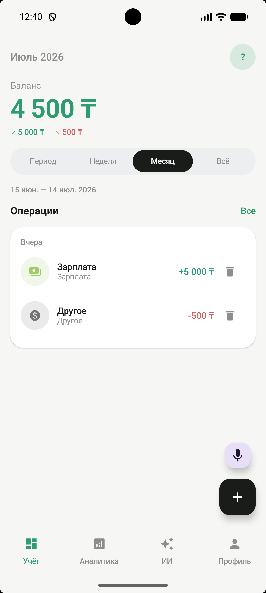
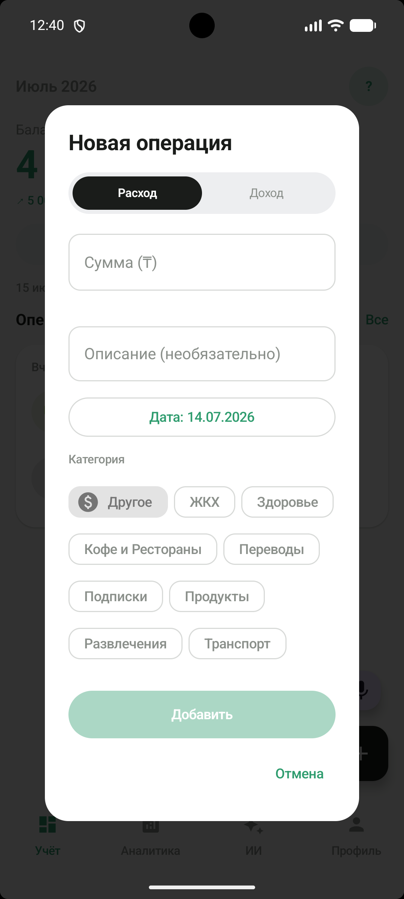
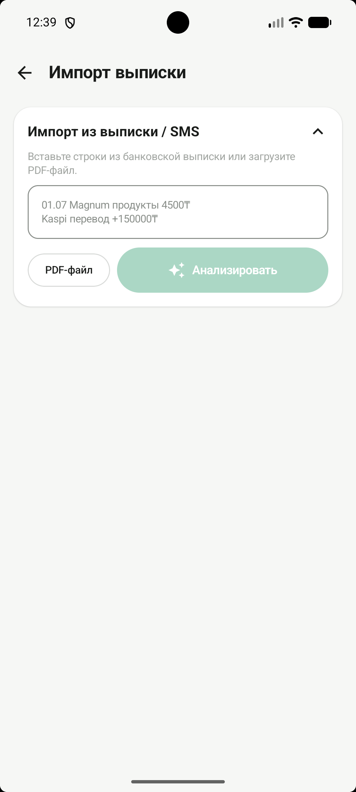
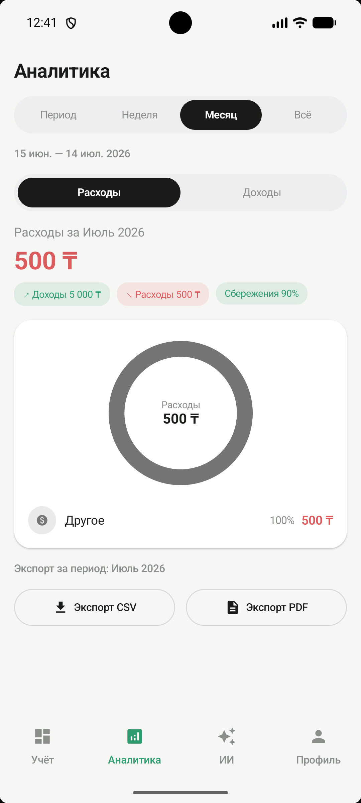
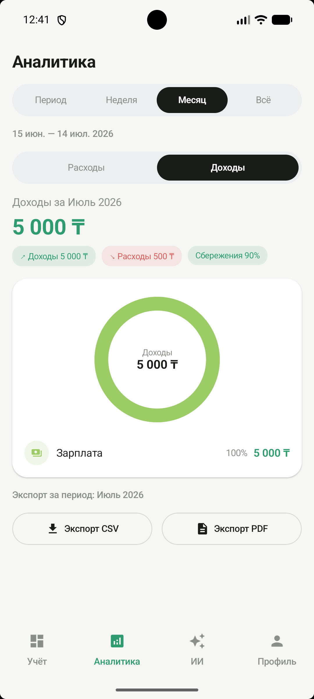
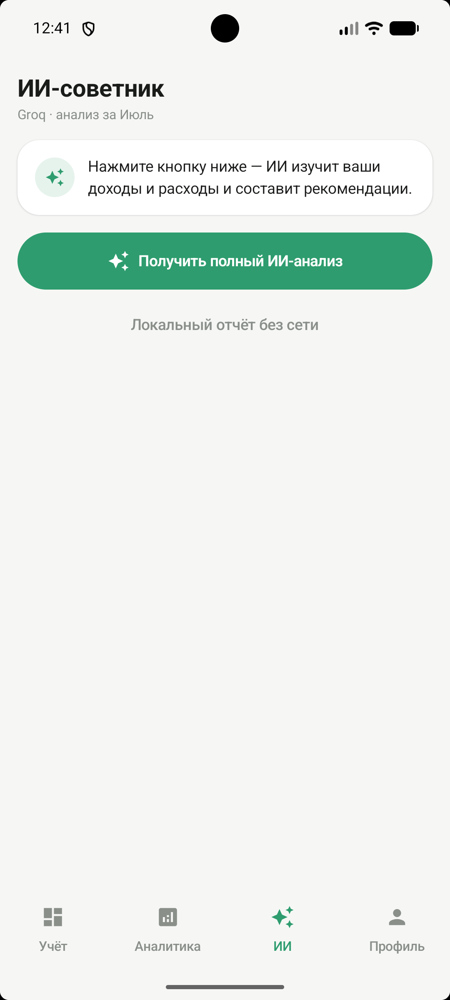
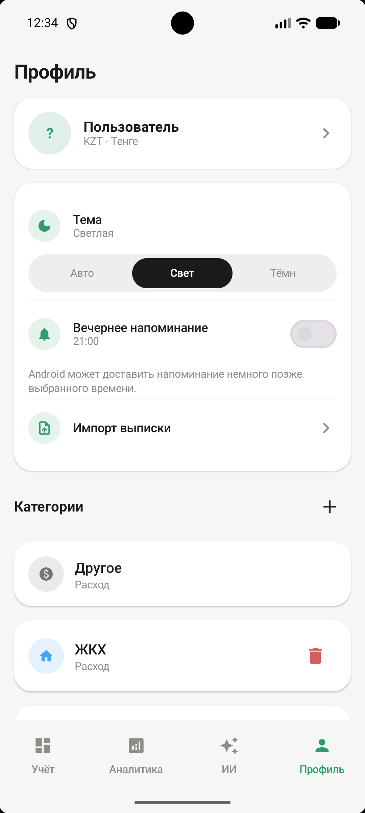

# WalletAI


Личное Android-приложение учёта доходов и расходов: Kotlin, Jetpack Compose, Room, KMP-модуль `shared/`, Groq API (советник) с кэшем и fallback на Gemini.

## Скриншоты

### Учёт и операции

<table>
  <tr>
    <td align="center"><br/>Главный экран</td>
    <td align="center"><br/>Добавление операции</td>
    <td align="center"><br/>Импорт выписки</td>
  </tr>
</table>

### Аналитика

<table>
  <tr>
    <td align="center"><br/>Расходы</td>
    <td align="center"><br/>Доходы</td>
  </tr>
</table>

### ИИ-советник и профиль

<table>
  <tr>
    <td align="center"><br/>ИИ-советник</td>
    <td align="center"><br/>Профиль и настройки</td>
  </tr>
</table>

<!-- Когда доснимешь тёмную тему:
### Светлая и тёмная тема
<table><tr>
  <td align="center"><br/>Светлая</td>
  <td align="center"><br/>Тёмная</td>
</tr></table>
-->

## Возможности

- Учёт операций, категории, undo удаления, семантика доход/расход
- Голосовой ввод (системный SpeechRecognizer) и импорт выписки (текст / PDF)
- Аналитика: донат-диаграмма, рейтинг категорий, календарные периоды, экспорт CSV/PDF
- ИИ-советник (Groq) с кэшем 24 ч и офлайн-fallback
- Профиль: валюта, тема, настраиваемое вечернее напоминание (WorkManager)

## Требования

- Android Studio (Koala+)
- JDK 11+
- Файл `.env` в корне проекта (см. `.env.example`)

```env
GROQ_API_KEY=ваш_ключ_groq
GEMINI_API_KEY=опционально_для_fallback
```

## Сборка и тесты

```bash
./gradlew :app:assembleDebug
./gradlew :shared:testAndroidHostTest :app:testDebugUnitTest
./gradlew :app:installDebug
```

APK: `app/build/outputs/apk/debug/app-debug.apk`

## Структура

```
app/       — Android UI, Room, DI (Koin), WorkManager, PDFBox
shared/    — KMP: domain, ML, AI (Ktor/Groq), unit-тесты
docs/      — ARCHITECTURE.md, PLAN.md
```

## Документация

- [PLAN.md](PLAN.md) — дорожная карта
- [docs/ARCHITECTURE.md](docs/ARCHITECTURE.md) — слои и потоки данных
- [AGENTS.md](AGENTS.md) — соглашения для разработки

## Gitflow

Ветка `develop` → feature-ветки → PR. Push и remote — вручную владельцем репозитория.
